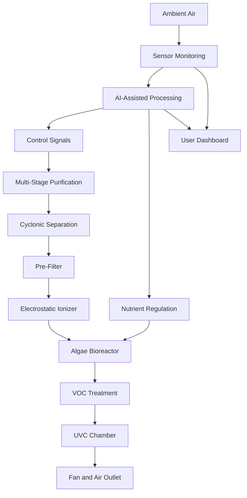
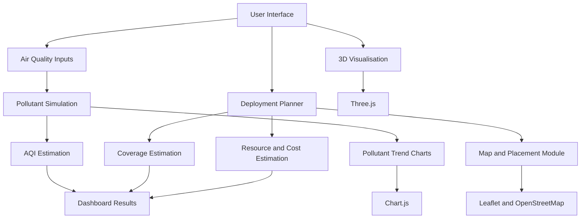

# 🌿 AIRJUNA — AI-Driven Algae-Based Air Purification System

<p align="center">
  <strong>Nature + Artificial Intelligence for a Cleaner, More Sustainable Future</strong>
</p>

<p align="center">
  
  
  
  
</p>

---

## 🌍 Overview

**AIRJUNA** is an AI-driven, algae-based air purification concept developed for **Smart India Hackathon 2025**, under Problem Statement **SIH25116**, in the Renewable and Sustainable Energy theme.

The project explores an alternative to conventional air purification by combining biological air treatment using living *Chlorella* microalgae with multi-stage filtration, environmental sensors, and intelligent control.

Traditional air purifiers primarily rely on replaceable filters. AIRJUNA proposes a more sustainable approach in which an algae-based bioreactor works alongside mechanical and chemical purification stages. An intelligent control system monitors air quality and environmental conditions to regulate purification and support algae health.

The project is accompanied by **ALVORA**, an interactive 3D visualisation and simulation platform. It demonstrates the proposed purification mechanism, pollutant trends, resource estimates, deployment planning, and comparisons with conventional purification approaches.

> **Project distinction:** AIRJUNA represents the proposed physical purifier and its hardware architecture. ALVORA is the interactive software platform used to visualise and simulate the concept. Simulation outputs are estimates, not certified measurements of a manufactured device.

## 🏆 Smart India Hackathon 2025

| Detail | Information |
|---|---|
| Hackathon | Smart India Hackathon 2025 |
| Project | AIRJUNA — AI-Driven Algae Purifier |
| Problem Statement ID | SIH25116 |
| Problem Statement Title | Student Innovation |
| Theme | Renewable / Sustainable Energy |
| Category | Hardware |
| Team Name | AIRJUNA |
| Team ID | 98513 |

## 💡 The Problem

Air pollution exposes people to harmful particulate matter, gases, and other contaminants. Conventional air purifiers can help address some of these pollutants, but they also have limitations:

- Dependence on replaceable filters and recurring maintenance.
- Filter disposal contributes to waste.
- Different purification technologies target different pollutant categories.
- Conventional systems do not necessarily account for biological processes or the environmental conditions needed to sustain them.
- Fixed operating modes may not respond efficiently to changing air quality.

AIRJUNA explores an integrated solution that combines filtration, biological treatment, sensing, and intelligent control.

## 🌱 Our Proposed Solution

AIRJUNA combines three major ideas:

1. **Multi-stage purification:** A sequence of filtration and treatment stages designed to address particulate matter, gases, and biological contaminants.
2. **Algae-based bioreactor:** Living *Chlorella* microalgae are incorporated as a biological component, using photosynthesis to absorb carbon dioxide under suitable operating conditions.
3. **AI-assisted monitoring and control:** Sensors provide environmental readings to an ESP32-based control architecture, which can regulate fans, purification stages, and nutrient delivery.

### Key Innovation

| Innovation | Purpose |
|---|---|
| AI + algae integration | Combines intelligent monitoring with biological purification |
| Algae bioreactor | Uses living microalgae as part of the purification concept |
| Multi-stage filtration | Targets multiple categories of air pollutants |
| Smart AQI monitoring | Supports adaptive operation based on environmental readings |
| Nutrient management | Helps maintain algae health |
| Modular architecture | Allows the proposed system to be adapted for different environments |
| Resource-aware operation | Considers energy and nutrient requirements |

## ⚙️ System Architecture

The proposed physical system consists of four main subsystems.

### 1. Multi-Stage Air Purification

The proposed airflow path includes:

| Stage | Component | Intended function |
|---|---|---|
| 1 | Canonical / Cyclonic Separator | Separates larger dust particles |
| 2 | Pre-filter | Captures larger airborne particles |
| 3 | Electrostatic Ionizer | Supports particle charging and collection |
| 4 | Algae Bioreactor | Uses *Chlorella* microalgae for biological treatment |
| 5 | VOC Treatment Stage | Targets volatile organic compounds |
| 6 | UVC Chamber | Provides ultraviolet-C treatment |
| 7 | Fan | Maintains airflow through the system |
| 8 | Energized Iron Ring | Proposed additional treatment component |

### 2. Sensor Subsystem

The proposed sensor architecture includes:

- PM sensor — monitors particulate matter.
- VOC sensor — monitors volatile organic compounds.
- Temperature sensor — monitors operating temperature.
- Humidity sensor — monitors environmental humidity.
- Optional CO₂ sensor — supports carbon dioxide monitoring.
- Optional differential-pressure sensor — can help monitor airflow or filter resistance.

### 3. Intelligent Control Unit

The proposed control architecture uses an **ESP32 microcontroller** with cloud integration.

Its responsibilities include:

- Collecting sensor readings.
- Monitoring air-quality conditions.
- Adjusting fan operation.
- Controlling purification stages.
- Regulating nutrient delivery.
- Logging operational data.
- Supporting remote monitoring through a dashboard.

### 4. Support Systems

The proposed hardware also includes:

- Nutrient supply pump.
- Power supply unit.
- Relays and motor drivers.
- Door interlock.
- Surge protection.
- Supporting energy-management components.

## 🔄 Working Principle

The overall proposed workflow is:



### Biological Component: *Chlorella* Microalgae

The biological component is based on the use of *Chlorella*, a photosynthetic microalga.

Under suitable conditions, microalgae use light and carbon dioxide for photosynthesis. AIRJUNA proposes integrating this biological process into an engineered air-treatment system.

The proposed concept also explores nutrient recycling and automated nutrient delivery to support algae cultivation.

**Important:** Actual pollutant removal, algae growth, biological stability, and long-term performance require controlled physical testing and validation.

---

## 🖥️ ALVORA — 3D Visualisation & Simulation Platform

ALVORA is the software companion to the AIRJUNA concept. It provides an interactive environment for exploring the proposed purifier and analysing simulated operating conditions.

### Platform Capabilities

#### 1. Interactive 3D Mechanism Explorer

The platform includes a 3D visualisation of the purification mechanism, allowing users to explore the system and its individual components.

Visualised mechanisms include:

- ALVORA purification assembly.
- HEPA filtration.
- Plasma ionisation.
- Activated carbon filtration.

The 3D environment uses Three.js and OrbitControls for interactive scene navigation.

#### 2. Air Quality Simulation

The simulation accepts pollutant inputs such as:

- PM2.5
- PM10
- NO₂
- VOCs

It displays estimated pollutant behaviour and visualises trends using charts.

#### 3. Purification Comparison

The platform provides a comparison interface for:

- ALVORA
- HEPA
- Plasma Ionisation
- Activated Carbon

The comparison uses configured pollutant-reduction factors. These are simulation assumptions rather than experimentally measured removal efficiencies.

#### 4. Resource Monitoring

The dashboard includes estimated resource indicators, including:

- Power consumption.
- Energy usage.
- Water requirements.
- Nutrient requirements.
- Operating modes.

#### 5. Deployment and Placement Planning

The planning interface supports:

- Map-based placement.
- Route-based deployment planning.
- Area-based deployment estimation.
- Pollution-source placement.
- Wind-speed and wind-direction inputs.
- Estimated purifier coverage.
- Operational and financial estimates.

The map interface uses Leaflet and OpenStreetMap-based mapping.

#### 6. AQI Monitoring

The platform supports manual pollutant inputs and an optional live AQI integration through the World Air Quality Index (WAQI) API.

A valid API token is required for live data access.

#### 7. Simulation Controls

The simulation interface supports:

- Play.
- Pause.
- Reset.
- Pollutant input adjustment.
- Air-quality trend visualisation.
- Estimated cleanup-time analysis.

### ALVORA Software Architecture



## 🛠️ Technology Stack

### ALVORA Software Platform

| Technology | Purpose |
|---|---|
| HTML5 | Application structure |
| CSS3 | Custom styling |
| Tailwind CSS | Utility-based styling |
| JavaScript (ES6+) | Application logic and simulation |
| Three.js | Interactive 3D visualisation |
| OrbitControls | 3D scene navigation |
| Chart.js | Pollutant and performance charts |
| Leaflet.js | Interactive maps |
| Leaflet Routing Machine | Route visualisation |
| OpenStreetMap | Map tiles |
| WAQI API | Optional live air-quality data |
| Google Fonts — Inter | Typography |

### Proposed Hardware Architecture

| Component | Role |
|---|---|
| ESP32 | Microcontroller and system control |
| PM Sensor | Particulate monitoring |
| VOC Sensor | Gas monitoring |
| Temperature and Humidity Sensors | Environmental monitoring |
| Optional CO₂ Sensor | Carbon dioxide monitoring |
| Nutrient Pump | Algae nutrient delivery |
| Fan | Airflow management |
| Relays and Drivers | Hardware switching and control |
| Power Supply | Electrical power |

---

## 📊 Simulation Parameters and Assumptions

The ALVORA implementation uses configurable parameters to estimate purification and resource behaviour.

Examples of parameters in the current simulation include:

| Parameter | Configured value |
|---|---:|
| Unit CADR | 800 |
| PM2.5 filter efficiency | 0.995 |
| PM10 filter efficiency | 0.99 |
| NO₂ filter efficiency | 0.70 |
| VOC filter efficiency | 0.95 |
| Base coverage radius | 75 |
| Effective height | 3 |
| Planner power consumption | 150 W |
| Water consumption estimate | 20 mL/hour |
| Nutrient consumption estimate | 5 mL/hour |
| Simulation tick interval | 500 ms |

These are software configuration values, not verified hardware specifications. Units and operating conditions should be confirmed before using them for engineering or deployment decisions.

### Model Interpretation

The current HTML implementation uses deterministic calculations and configured pollutant-reduction factors to generate simulation results.

Although the project concept includes AI-assisted sensing and control, the current simulator's pollutant prediction logic should not be interpreted as a trained deep-learning model. No trained neural-network weights or model-training pipeline are included in the supplied HTML implementation.

Similarly, coverage, cleanup-time, energy, water, nutrient, and cost estimates are model-based approximations. They require calibration against physical prototype measurements.

---

## 🚀 Getting Started

### Prerequisites

You need:

- A modern web browser.
- A local development server.
- Internet access for externally loaded libraries, map tiles, and optional live AQI data.

### Installation

**1. Clone the repository**

```bash
git clone https://github.com/YOUR-USERNAME/YOUR-REPOSITORY.git
```

**2. Navigate to the project directory**

```bash
cd YOUR-REPOSITORY
```

**3. Start a local server**

For Python:

```bash
python -m http.server 8000
```

**4. Open the application**

Visit:

```text
http://localhost:8000
```

Open the HTML application through the local server.

> The supplied software is currently a browser-based HTML/CSS/JavaScript application. It does not require a separate backend for its basic local simulation interface.

### Live AQI Integration

The application contains a WAQI API configuration.

For live AQI functionality:

1. Obtain a valid API token from the WAQI service.
2. Configure the token in the application.
3. Ensure the application can access the API.
4. Test the returned readings before relying on them.

The supplied HTML uses a demo token. Do not commit a private API token to a public GitHub repository. For production deployment, use a backend or serverless proxy to protect credentials.

---

## 📁 Suggested Repository

The current application is supplied as a browser-based HTML prototype. The following is a suggested structure for organising future development, not a claim that all these files already exist.


## 🌎 Feasibility and Expected Impact

AIRJUNA is designed around the possibility of combining biological treatment and engineered filtration in a modular air-purification system.

### Potential Benefits

- Reduced dependence on conventional disposable filter materials.
- Integration of biological and mechanical treatment.
- Intelligent monitoring of environmental conditions.
- Potential reduction in recurring filter-related costs.
- Adaptability to residential, office, and industrial environments.
- A sustainability-oriented approach to air purification.

### Challenges to Address

| Challenge | Proposed mitigation |
|---|---|
| Maintaining algae growth across different climates | Automated nutrient delivery and temperature regulation |
| Sensor calibration and long-term accuracy | Periodic calibration and monitoring |
| User adoption of algae-based purification | Demonstrations and transparent performance testing |
| Biological stability | Controlled cultivation and maintenance procedures |
| Energy optimisation | Sensor-driven control and operating-mode management |

### Expected Impact — Project Proposal

The original project presentation identifies the following as potential impact targets:

- Up to 35% reduction in indoor CO₂ over 24 hours.
- Improvement to healthy AQI levels in under 60 minutes in a standard room.
- Reduction of filter-disposal-related e-waste.

These figures are **proposed targets, not independently verified experimental results**. Actual performance will depend on room volume, initial pollutant concentration, airflow, algae health, environmental conditions, and system configuration.

---

## 🔬 Research Foundation

The biological concept draws on research concerning microalgae, photosynthesis, and algae cultivation.

Selected references from the project presentation:

1. P. G. Falkowski and J. A. Raven, *Aquatic Photosynthesis*. Princeton University Press, 2013. [Reference](https://www.researchgate.net/publication/41931921_Aquatic_Photosynthesis_Paul_G_Falkowski_John_A_Raven)

2. W. Blanken, M. Cuaresma, R. H. Wijffels, and M. Janssen, “Cultivation of microalgae on artificial light,” *Biotechnology Advances*, vol. 31, no. 3, pp. 164–186, 2013. [Read paper](https://www.sciencedirect.com/science/article/abs/pii/S221192641300091X)

3. L. Barsanti and P. Gualtieri, *Algae: Anatomy, Biochemistry, and Biotechnology*. CRC Press, 2014. [Read book details](https://www.taylorfrancis.com/books/mono/10.1201/b16544/algae-laura-barsanti-paolo-Gualtieri)

Additional references and experimental validation should be added as the project develops.

---

## 🛣️ Future Roadmap

- [ ] Develop and validate a physical algae-based purifier prototype.
- [ ] Integrate ESP32 with environmental sensors.
- [ ] Establish reliable sensor-to-controller communication.
- [ ] Implement automated fan and nutrient-pump control.
- [ ] Conduct controlled experiments using *Chlorella* cultures.
- [ ] Measure pollutant removal under repeatable conditions.
- [ ] Validate the simulation against experimental measurements.
- [ ] Improve the predictive model using collected sensor data.
- [ ] Add secure cloud-based monitoring.
- [ ] Conduct long-duration algae health and system reliability tests.
- [ ] Evaluate energy consumption and lifecycle cost.

## 🤝 Contributing

Contributions, suggestions, and research collaboration are welcome.

1. Fork the repository.
2. Create a feature branch:

```bash
git checkout -b feature/your-feature-name
```

3. Commit your changes:

```bash
git commit -m "Add: your feature description"
```

4. Push your branch:

```bash
git push origin feature/your-feature-name
```

5. Open a Pull Request describing your changes.

Please distinguish simulation enhancements from experimentally validated hardware results when contributing.

## 📜 License

No open-source license has been specified yet. Until a license is added to the repository, all rights remain with the respective copyright holder. Please add a suitable `LICENSE` file before permitting reuse or redistribution.

---

## 👥 Project Team

**AIRJUNA — Smart India Hackathon 2025**

Team ID: **98513**

Developed as a student innovation project under the Renewable and Sustainable Energy theme.

---

<p align="center">
  <strong>🌿 AIRJUNA — Where Nature Meets Intelligent Engineering</strong>
  <br/>
  <em>Reimagining air purification through biological innovation and smart technology.</em>
</p>
